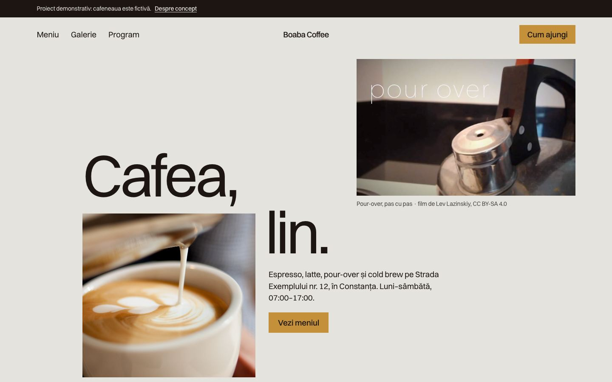
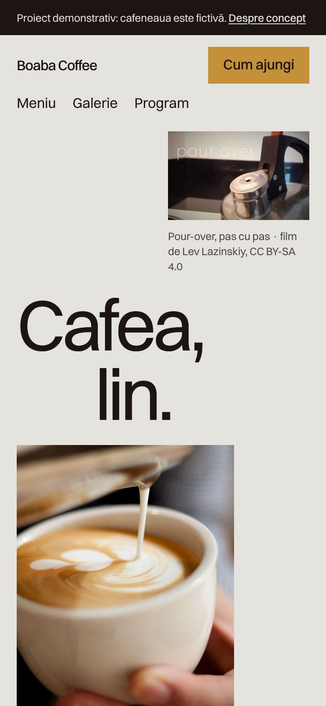
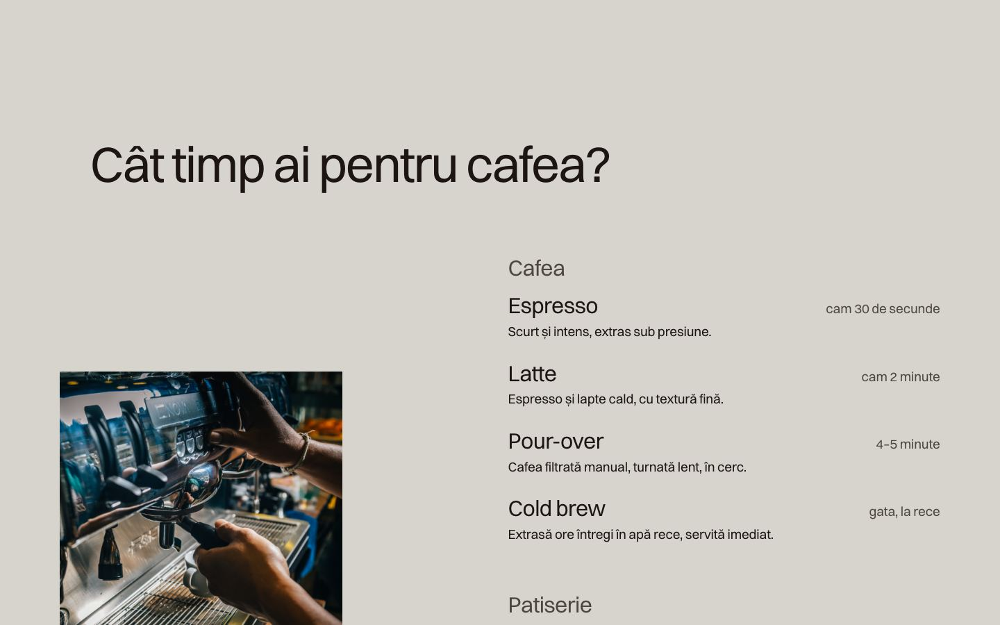

# Boaba Coffee



Site pentru o cafenea de specialitate, cu meniu editabil dintr-un panou de administrare (Python).

> Proiect demonstrativ. Firma, adresa, telefoanele, emailurile și recenziile sunt fictive. Orice asemănare cu o firmă reală este întâmplătoare.

## Capturi de ecran

| Prima pagină, telefon | Meniul |
|---|---|
|  |  |

## Tehnologii

HTML, CSS și JavaScript simplu, cu un server Python (doar biblioteca standard) pentru panoul de administrare.

## Decizii tehnice

- Serverul `server.py` servește site-ul și un mic API: meniul, programul și anunțul se editează din `admin.html` și se salvează în `data/site.json`.
- Parola de administrare vine din variabila `ADMIN_PASSWORD`; fără ea, serverul generează una la pornire.
- Imaginile și filmul au licențe libere (CC0, domeniu public, CC BY-SA), cu sursa trecută în `assets/found/credits.json`.
- Conținutul e inclus direct în pagină, deci site-ul se afișează și pe un hosting static; doar panoul de administrare are nevoie de `server.py`.
- Accesibilitate: link „Sari la conținut”, mesaje anunțate cititoarelor de ecran (aria-live), focus vizibil la navigarea cu tastatura.
- Animațiile se reduc sau se opresc pentru cine a setat „reducerea mișcării” în sistem (`prefers-reduced-motion`).
- Imaginile din afara ecranului se încarcă abia când e nevoie de ele (`loading="lazy"`).

## Rulare

```bash
python3 server.py
```
Panoul de administrare cere o parolă setată în variabila de mediu `ADMIN_PASSWORD`.

## Cum a fost realizat

Proiectul a fost conceput și dezvoltat de Cristian Lucaci. În procesul de creație am folosit și instrumente de inteligență artificială, ca sprijin la scrierea codului, la texte și la verificări. Deciziile de design, alegerile tehnice și forma finală îmi aparțin.

## Licență

Codul este publicat sub licența [MIT](LICENSE), © 2026 Cristian Lucaci.

Resursele terțe incluse (fonturi, biblioteci, fotografii sau modele 3D cu licență liberă) își păstrează licențele proprii, menționate lângă fișiere sau în pagină. Imaginile fără sursă menționată sunt grafică generată pentru acest proiect.
